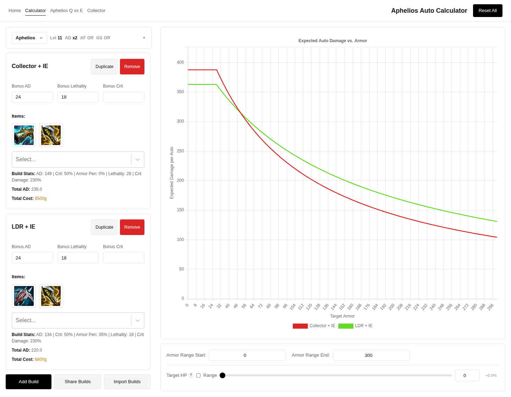

# Damagecalc

A League of Legends calculator for comparing item builds, Aphelios passive leveling, and The Collector's execute contribution.

**[Open the app](https://damagecalc.vercel.app)**



## Tools

- **[Build calculator](https://damagecalc.vercel.app/calculator):** compare expected damage per auto against a range of armor values. Supports Aphelios and Draven, rune bonuses, Draven's Spinning Axe, and manual bonus stats. Builds can be saved in the browser and shared by URL or import code.
- **[Aphelios Q vs E](https://damagecalc.vercel.app/aphelios-cutoff):** plan purchases for both players across levels, compare AD and lethality upgrades, and inspect where recommendations change. A dynamic-programming optimizer compares complete legal leveling paths with the greedy choice at each level.
- **[Collector](https://damagecalc.vercel.app/collector):** explore average execute damage and the extra damage needed to match a fixed attack count. These are separate measures; the average execute contribution is not an equivalent damage buff.

The calculator measures damage per attack. Attack speed, most item passives, and full combat sequences are outside its scope. See [Calculations](docs/CALCULATIONS.md) for the formulas and assumptions.

## Run locally

Use Node.js 22 and npm. From the repository root:

```bash
cd league-calculator
npm ci
npm run dev
```

Open [localhost:3000](http://localhost:3000). To use another port, run `npm run dev -- --port 3100`.

For a production build, run these commands from `league-calculator/`:

```bash
npm run build
npm start
```

The app includes generated game data and item icons, so running it does not require Python or an API key. Dependency installation and the Google font download used by Next.js require network access.

## Implementation

Next.js 15 App Router, React 19, TypeScript, Chart.js, and CSS with Tailwind. Calculations and interactive state run in the browser. A separate Python generator uses Cassiopeia and CommunityDragon to update the checked-in game data through GitHub Actions. The live app is hosted on Vercel.

| Reference | Contents |
| --- | --- |
| [Project map](FEATURES.md) | Routes, state, and source files |
| [Calculations](docs/CALCULATIONS.md) | Damage formulas, leveling objective, and Collector assumptions |
| [Data updates](docs/DATA.md) | Sources, generation, overrides, and scheduled updates |
| [Build sharing](league-calculator/encoder-demo.md) | Import/export format and what a share preserves |

For another deployment, set the project root to `league-calculator`. Optional `NEXT_PUBLIC_SITE_URL` sets canonical and social-sharing URLs; it defaults to `https://damagecalc.vercel.app`.

League of Legends and the game assets used here belong to Riot Games. This is an independent project.
